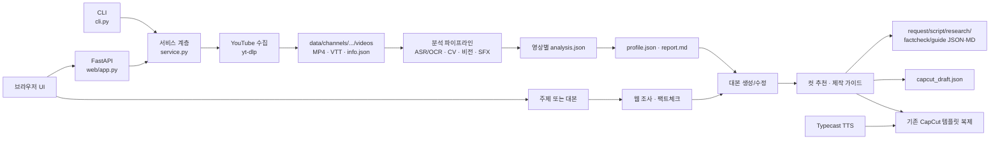

# 현재 아키텍처 분석

작성일: 2026-07-27  
분석 범위: `D:\youtube\shortly`의 소스, 설정, 빌드 산출물, 데이터 디렉터리  
분석 방식: 정적 코드 조사와 Python AST 구문 검증. 외부 API, YouTube 다운로드, TTS, 모델 서버, CapCut 쓰기는 실행하지 않았다.

## 1. 요약

Shortly는 Python 단일 패키지와 정적 HTML/JavaScript UI로 구성된 로컬 웹 애플리케이션이다. CLI와 FastAPI가 `shortly/service.py`의 절차형 서비스 함수를 공유한다. 채널 수집 → 영상별 분석 → 채널 프로필 집계 → 조사/대본/팩트체크 → 컷 추천/가이드 → 일반 JSON 초안 또는 실제 CapCut 프로젝트 복제의 흐름이다.

현재 구조의 장점은 UI와 CLI 사이에 서비스 계층이 이미 있다는 점, LLM에 최소 공통 인터페이스가 있다는 점, 결과가 파일 기반이라 이식이 쉽다는 점이다. 가장 큰 구조적 위험은 다음과 같다.

- `service.py`와 1,600줄이 넘는 `generate/capcut_export.py`에 오케스트레이션, 파일 저장, 외부 호출, 플랫폼 로직이 결합돼 있다.
- “팀용 포터블”은 런타임 프로파일이라기보다 `SHORTLY_PORTABLE` 분기와 소스 전체 복사 방식이다. SFX는 런타임에서 꺼지지만 관련 코드가 빌드에서 제외되지는 않는다.
- 팀용 빌드는 Windows AMD64, Windows CapCut 경로, Windows 폰트, Inno Setup, VBS/BAT에 종속된다.
- 루트 `.env`에 실제 비밀 값이 존재하고 `.gitignore`가 없다. API 키는 평문 파일에 저장된다.
- 앱 자체 테스트가 없고, 의존성 상한/잠금 파일이 없다. 기존 `dist/shortly-app`은 약 2.65 GiB이며 34,352개 파일을 포함한다.

## 2. 사용 언어와 프레임워크를 포함한 확인된 기술 스택

| 영역 | 확인된 구현 | 근거 |
|---|---|---|
| 언어 | Python 3.10 이상, 브라우저 JavaScript/CSS/HTML | `pyproject.toml`, `shortly/web/static/*` |
| 웹 서버 | FastAPI + Uvicorn + Pydantic | `shortly/web/app.py`, `requirements.txt` |
| 프론트엔드 | 빌드 단계 없는 단일 페이지 정적 UI | `shortly/web/static/index.html`, `app.js`, `style.css` |
| 영상 수집 | `yt-dlp` | `shortly/ingest/youtube.py` |
| 영상 처리 | FFmpeg/ffprobe 외부 실행, OpenCV, PySceneDetect | `shortly/utils.py`, `analyze/video_cv.py` |
| 음성/문자 분석 | faster-whisper, EasyOCR(선택적 폴백) | `analyze/transcript.py` |
| 효과음 분석 | NumPy/SciPy 자체 지문, 선택적 Demucs/CLAP | `shortly/sfx/*`, `analyze/audio_sfx.py` |
| LLM | Gemini, OpenAI, Anthropic, OpenAI 호환 로컬 서버 | `shortly/llm/*` |
| TTS | Typecast REST API, 표준 라이브러리 `urllib` | `shortly/tts/typecast.py` |
| 이미지 | Pillow로 자리표시자 및 프레임 생성 | `generate/capcut_export.py` |
| 패키징 | setuptools, 자체 포터블 빌더, 임베디드 Python/FFmpeg, Inno Setup | `pyproject.toml`, `shortly/portable/*` |
| 저장 | JSON, Markdown, VTT, WAV/MP4/JPG, NPZ/pickle 파일 | `data/`, `shortly/utils.py` |

`requirements.txt`에는 필수와 선택 의존성이 한 파일에 섞여 있다. 주석과 달리 OpenAI 및 Gemini SDK는 주석 처리돼 있고 Anthropic만 기본 설치된다. 반면 `faster-whisper`, `easyocr`, `opencv-python` 같은 무거운 분석 패키지는 팀용 requirements에도 포함된다.

## 3. 실행 방식

### 개발/개인 실행

- `python -m shortly <명령>` → `shortly/__main__.py` → `shortly/cli.py`
- `shortly` 콘솔 스크립트 → `shortly.cli:main` (`pyproject.toml`)
- `python -m shortly web` → `shortly.web.app.run()` → Uvicorn

CLI 명령은 `build-sfx`, `learn`, `guide`, `list`, `status`, `web`, `build-portable`, `build-installer`다.

### 설치형 실행

`run_shortly.py`가 `shortly.portable.launcher.main`을 호출한다. 런처는:

1. `SHORTLY_PORTABLE=1`과 localhost/포트를 설정한다.
2. 번들 FFmpeg를 `PATH` 앞에 넣는다.
3. `%LOCALAPPDATA%\Shortly` 아래에 데이터, TTS, `.env`, 로그를 만든다.
4. FastAPI 앱을 Uvicorn으로 띄우고 브라우저를 연다.

폴더형 포터블 빌드와 설치형 빌드가 별도로 존재한다. 설치형은 Python 3.12.10 Windows AMD64 임베디드 ZIP과 gyan.dev FFmpeg ZIP을 내려받고, 가능하면 Inno Setup 6으로 `ShortlySetup.exe`를 만든다.

## 4. 주요 디렉터리와 역할

```text
shortly/
├── cli.py                  # CLI 어댑터
├── service.py              # UI/CLI 공용 유스케이스 및 파일 저장
├── config.py               # .env 로드/저장, 경로, 배포 모드
├── ingest/youtube.py       # Shorts 목록 조회·다운로드·manifest
├── analyze/
│   ├── transcript.py       # VTT 선택, Whisper 폴백, OCR
│   ├── video_cv.py         # 컷·전환·키프레임·모션
│   ├── vision.py           # LLM 기반 쇼츠 해석
│   ├── image_content.py    # 컷별 이미지 사용 분석
│   ├── layout.py           # OCR/비전 기반 자막 배치
│   ├── audio_sfx.py        # 효과음 검출 연결
│   └── style_profile.py    # 영상별 결과를 채널 프로필로 집계
├── llm/
│   ├── base.py             # LLMClient와 JSON 파싱
│   ├── factory.py          # 설정 기반 구현 선택
│   ├── openai_client.py    # OpenAI 및 로컬 OpenAI 호환 서버
│   ├── anthropic_client.py
│   └── gemini.py
├── generate/
│   ├── research.py         # DDGS/HTML 검색과 LLM 요약
│   ├── script_gen.py       # 대본 생성·수정과 규칙 폴백
│   ├── factcheck.py        # 추가 검색 및 LLM 기반 수정
│   ├── guide.py            # 제작 가이드 조립
│   ├── image_reco.py       # 컷별 이미지/매체/효과 추천
│   └── capcut_export.py    # 일반 초안과 실제 CapCut 프로젝트 생성
├── tts/typecast.py         # Typecast TTS
├── sfx/                    # 카탈로그, 지문, CLAP/Demucs
├── portable/               # Windows 포터블/설치형 빌드와 런처
└── web/
    ├── app.py              # FastAPI API, 인메모리 작업 큐, 정적 파일
    └── static/             # 브라우저 UI
```

루트의 `_tmp_*`, `_make_*`, `_tts_once.py`, `_plan_check.txt`는 개인 실험/일회성 스크립트다. 일부에는 특정 사용자와 특정 작업 폴더의 절대 경로가 있다. 앱 패키지에는 포함되지 않지만 소스 배포나 저장소 공유 시 노출된다.

## 5. 현재 데이터 흐름



### 프론트엔드/백엔드/로컬 프로세스

- 프론트엔드는 `fetch`와 SSE로 FastAPI API를 호출한다.
- 긴 작업은 `threading.Thread`로 실행되며 `JOBS` 전역 딕셔너리와 `queue.Queue`에 상태를 둔다.
- 별도 워커 프로세스나 영속 작업 저장소는 없다. 앱 재시작 시 작업 상태가 사라지고, 작업 정리 정책도 없다.
- FFmpeg, ffprobe, yt-dlp, 선택적 모델 라이브러리 및 CapCut 파일시스템은 모두 FastAPI 프로세스가 직접 사용한다.

## 6. 채널 학습 파이프라인

`service.learn_channel`과 `analyze_one_video`가 다음을 조정한다.

1. `ingest_channel`이 채널 Shorts 목록을 조회하고 조회수 순으로 다운로드한다.
2. VTT가 있으면 자막을 사용하고 없으면 faster-whisper를 시도한다.
3. 요청에 따라 EasyOCR로 화면 자막을 읽고 배치 정보를 추출한다.
4. OpenCV/PySceneDetect로 컷, 전환, 모션, 키프레임을 분석한다.
5. 분석 LLM이 키프레임과 쇼츠 구조를 해석한다. LLM이 없으면 일부 휴리스틱으로 폴백한다.
6. 개인 모드에서는 효과음 분석을 추가한다.
7. 영상별 `analysis.json`을 저장한다.
8. `aggregate_profile`이 모든 분석을 `profile.json`과 사람이 읽는 `report.md`로 집계한다.

분석 캐시는 영상 폴더의 `analysis.json`이다. `force`와 backfill 함수로 일부 분석을 재실행한다. 캐시 스키마 버전이나 마이그레이션 식별자는 없다.

## 7. AI 모델 호출 구조

### 공통 추상화

`LLMClient`는 다음 세 메서드를 정의한다.

- `complete_text(system, user, temperature, max_tokens)`
- `complete_json(...)`
- `describe_image(image_path, prompt, ...)`

`get_llm(settings, role)`은 `analysis`와 `generation` 역할에 따라 공급자/모델을 고른다. 이 추상화는 유용하지만 다음 정보가 인터페이스에 없다.

- 공급자 기능(capability), JSON 네이티브 출력, 스트리밍
- 타임아웃, 취소, 재시도, rate limit
- 토큰/비용/요청 ID
- 관찰 가능성 및 민감정보 마스킹
- 이미지 MIME 유형(현재 모든 이미지가 JPEG로 가정됨)

### 로컬 Qwen

로컬 모델은 별도 Qwen 전용 클라이언트가 아니다. `local`, `ollama`, `lmstudio`, `llamacpp`를 `OpenAIClient`에 연결하고 `SHORTLY_LOCAL_BASE_URL`과 로컬 API 키를 전달한다.

- 기본 Ollama URL: `http://localhost:11434/v1`
- README 예시 텍스트 모델: Qwen 계열
- UI는 `<base_url>/models`를 호출해 모델 목록을 가져온다.
- `SHORTLY_LOCAL_NO_THINK`가 참이면 시스템/비전 프롬프트에 `/no_think`를 붙이고 `<think>`를 제거한다.
- 텍스트와 비전 모델을 따로 지정할 수 있지만, 비전 모델이 비면 텍스트 모델을 재사용한다.

확인된 사실은 “OpenAI 호환 로컬 서버 연결”이다. 특정 Qwen 모델 파일을 직접 로드하거나 관리하는 코드는 없다.

### OpenAI

`openai` SDK의 Chat Completions API를 사용한다. 텍스트와 base64 이미지 메시지를 지원한다. SDK가 기본 requirements에 없으므로 사용자가 별도 설치하지 않으면 `available=False`다.

### Anthropic

`anthropic.Anthropic.messages.create`를 사용한다. 일부 새 모델이 temperature를 거절할 경우 temperature 없이 한 번 재시도한다. 팀 포터블 모드에서는 분석/비전과 생성 공급자를 Anthropic으로 강제하고 모델명도 상수로 고정한다.

### Google Gemini

구형 `google.generativeai` SDK를 지연 import한다. SDK는 requirements에서 주석 처리돼 있다. 텍스트와 이미지 설명을 지원한다.

## 8. 조사, 대본, 자막 및 컷

- `research.py`: 주제에서 검색어를 만들고 `ddgs`를 우선 사용하며, 실패하면 DuckDuckGo HTML을 직접 요청한다. 검색 결과 스니펫을 LLM으로 구조화한다.
- `script_gen.py`: 채널 프로필과 조사 결과를 프롬프트에 넣어 구조화 JSON 대본을 만든다. LLM이 없거나 실패하면 휴리스틱 대본으로 폴백한다.
- `factcheck.py`: 주장 후보를 추가 검색하고 LLM으로 문제/수정안을 만든다.
- `guide.py`: 대본 세그먼트, 예상 시간, TTS 설정, 자막/효과음 권장을 조립한다.
- `image_reco.py`: 채널의 `image_style`/`editing_style`을 이용해 컷 수, 이미지, 매체, 효과를 LLM 또는 휴리스틱으로 추천한다.

현재 “자막 생성”은 두 의미가 섞여 있다.

1. 학습 입력에서는 VTT/ASR/OCR로 기존 영상의 음성과 화면 글자를 분석한다.
2. 생성 출력에서는 대본 문장을 자막 단위로 쪼개 CapCut 텍스트 트랙을 만든다.

독립적인 `SubtitleDocument`나 `CutManifest` 데이터 모델은 없으며 중첩 `dict`가 모듈 사이 계약 역할을 한다.

## 9. TTS 구조

`TypecastConfig`와 `synth_wav`/`synth_to_file`로 구성된다. API 키, 음성 ID, 모델, 언어, 감정, 강도, 속도 등이 환경변수에서 로드된다.

- Typecast API에 JSON을 POST하고 WAV 바이트를 받는다.
- 텍스트 길이 제한을 검사한다.
- CapCut 템플릿 내보내기에서 문장별 WAV를 생성하고 해시 기반 캐시 경로를 사용한다.
- 현재 TTS는 일반 가이드 생성 시 즉시 실행되지 않고 실제 CapCut 템플릿 내보내기 단계에서 사용된다.
- TTS 공급자 인터페이스, 비용 기록, 재시도 정책, 요청 취소는 없다.

## 10. CapCut 생성 구조

두 수준이 있다.

### 중립 초안

`export_capcut_draft`는 자체 `shortly_schema: capcut-draft-v0` JSON을 저장한다. 이는 공식 CapCut 프로젝트라기보다 타임라인 설계도다.

### 실제 프로젝트

`export_to_capcut_project`와 `export_via_template`는 설치된 CapCut 프로젝트 루트를 찾고 기존 프로젝트의 `draft_content.json`/메타데이터와 소재를 복제한다. 텍스트, 이미지 자리표시자, 추천 메모, TTS 오디오 트랙을 추가하고 프로젝트 ID를 재생성한다.

주요 결합:

- Windows의 `%LOCALAPPDATA%`/`%APPDATA%` 아래 CapCut 경로만 탐색한다.
- Windows 폰트 경로를 직접 조회한다.
- 사용자의 기존 CapCut 프로젝트가 스키마 템플릿 역할을 한다.
- `SHORTLY_CAPCUT_TEMPLATE` 기본값이 개인 채널명에 맞춰져 있다.
- CapCut 스키마 버전 검증, 원자적 쓰기, 백업/복구 계약이 명시적이지 않다.

따라서 macOS 지원은 현재 확인되지 않았으며 실제 구현상 지원되지 않는 것으로 판단한다. 공식 CapCut 프로젝트 스키마가 저장소에 고정돼 있지 않아 사용자 PC의 템플릿 상태가 핵심 런타임 의존성이다.

## 11. 설정, 파일 저장 및 캐시

### 설정 우선순위

`config.py`는 프로젝트 `.env`, 번들 `env.defaults`, 포터블 사용자 `.env`를 차례로 읽는다. 포터블 사용자 `.env`는 override로 적용된다. 웹 UI의 설정 저장은 허용된 키만 기존 `.env`에 병합한다.

주요 설정:

- LLM/생성 공급자, 모델, API 키, 로컬 서버 URL
- Typecast 키/음성/속도/감정
- 데이터, SFX, TTS 출력 경로
- CapCut 템플릿명
- 학습 개수/조회수, 서버 host/port/LAN 제한
- 조사/팩트체크 활성화

`.env.example`에는 `SHORTLY_MIN_VIEWS`, `SHORTLY_LOCAL_NO_THINK`, Typecast의 일부 세부 설정 등이 코드와 완전히 일치하는지 재정비가 필요하다.

### 저장 위치

개발 모드:

```text
<project>/data/
├── channels/<slug>/
│   ├── channel.json
│   ├── profile.json
│   ├── report.md
│   ├── videos/<video-id>/
│   │   ├── video.*
│   │   ├── video.*.vtt
│   │   ├── frames/*.jpg
│   │   └── analysis.json
│   └── outputs/<title>/
│       ├── request.json
│       ├── script.json
│       ├── research.json
│       ├── factcheck.json
│       ├── guide.json
│       ├── guide.md
│       └── capcut_draft.json
├── sfx_index/
└── tts_out/
```

설치형:

```text
%LOCALAPPDATA%\Shortly\
├── .env
├── shortly.log
├── data/
└── tts_output/
```

현재 작업 폴더에는 채널 1개, 영상/분석 48개, 생성 가이드 16개가 있으며 `data/`는 약 151.53 MiB다.

## 12. 운영체제·개인 경로 종속성

확인된 개인/Windows 종속성:

- `config.py`의 기본 TTS 출력 `D:\youtube\...` 및 SFX `D:\youtube\DaelhyukGisang\sfx_sound`
- 개인 CapCut 템플릿 기본명
- 루트 임시 스크립트의 `C:\Users\preister\...`, `D:\youtube\...`
- CapCut 탐색, 폰트, VBS/BAT, `taskkill`, embedded-amd64, Inno Setup
- 설치형 데이터 위치가 `%LOCALAPPDATA%`로 고정

`pathlib` 사용 덕분에 분석 코어는 대체로 플랫폼 중립이지만, 실제 CapCut 내보내기와 설치 패키지는 Windows 전용이다.

## 13. 배포를 어렵게 만드는 의존성

- FFmpeg/ffprobe 실행 파일
- yt-dlp의 YouTube 변경 대응
- OpenCV/PySceneDetect
- faster-whisper/CTranslate2와 EasyOCR/PyTorch의 큰 용량
- 선택적 Demucs/CLAP/PyTorch
- 각 LLM SDK 버전과 모델명 유효성
- 네트워크 조사 및 외부 API
- 사용자 CapCut 설치 및 최소 1개 호환 템플릿 프로젝트
- Windows 폰트와 CapCut 내부 JSON 스키마

기존 설치형 산출물이 2.65 GiB인 것은 번들 `site-packages`에 torch 등 대형 의존성과 그 테스트/메타데이터가 포함된 영향이다. 이것은 팀 배포 경험의 직접적인 장애물이다.

## 14. 테스트, 빌드, 패키징 및 Git 상태

### 테스트

- 저장소 자체 `tests/` 또는 앱 테스트 파일은 발견되지 않았다.
- 번들 `dist/` 안의 의존 패키지 테스트는 앱 테스트가 아니다.
- 43개 Python 파일은 번들 Python으로 AST 파싱에 성공했다.
- 외부 API/CapCut/다운로드를 건드리는 실행 테스트는 제한에 따라 수행하지 않았다.

### 빌드

- setuptools 메타데이터는 최소 수준이며 런타임 dependencies가 `pyproject.toml`에 선언돼 있지 않다.
- 잠금 파일, 해시 고정, SBOM, 서명, CI 구성이 없다.
- 포터블 빌더는 `shortly/` 전체를 복사하고 `.env`, 캐시, 임시 파일을 일부 제외한다.
- 팀 빌드에서도 SFX/로컬 LLM 구현 소스 자체는 복사된다.
- 빌드가 네트워크에서 Python, get-pip, FFmpeg, PyPI 패키지를 즉시 내려받아 재현성이 낮다.

### Git

`git status --short --branch`는 “not a git repository”로 실패했고 현재 폴더 및 확인 가능한 상위 폴더에서 `.git`을 찾지 못했다. 따라서 다음은 확인할 수 없다.

- 추적/미추적 파일
- 현재 브랜치와 변경 상태
- `.env` 또는 `data/`, `dist/`의 커밋 이력
- 기존 문서 변경 이력

이는 “현재 전달본에 Git 메타데이터가 없음”이라는 확인된 사실이다. 원본 저장소가 별도 위치에 있을 가능성은 추가 확인 사항이다.

## 15. 확인된 사실과 추정의 구분

### 확인된 사실

- FastAPI와 CLI가 `service.py`를 공유한다.
- 로컬 Qwen은 OpenAI 호환 서버를 통해 연결한다.
- 팀 포터블 모드는 Anthropic 공급자/모델을 코드에서 강제하고 SFX를 비활성화한다.
- Typecast TTS는 실제 CapCut 내보내기에 통합돼 있다.
- 실제 CapCut 내보내기는 기존 프로젝트를 템플릿으로 복제한다.
- 실제 값이 든 `.env` 키가 있고 `.gitignore`가 없다.
- API 키는 평문 `.env`에 저장된다.
- 앱 테스트와 Git 메타데이터가 없다.

### 추정 또는 외부 확인 필요

- 하드코딩된 Anthropic 모델명이 실제 API에서 현재 사용 가능한지는 호출하지 않아 확인하지 않았다.
- CapCut의 특정 버전별 호환성과 macOS 프로젝트 위치는 확인하지 않았다.
- 팀원이 실제로 쓰는 기능의 정확한 빈도와 필수성은 코드만으로 확정할 수 없다.
- 현재 `dist/shortly-app`이 팀원에게 실제 전달된 최종본인지 확인하지 않았다.

## 16. 이 문서의 결론

가장 먼저 보존해야 할 경계는 `service.py` 위의 UI/CLI가 아니라 그 아래의 도메인 결과 계약이다. `profile`, `script`, `guide`, `capcut_draft`를 명시적 모델로 고정한 뒤, LLM/TTS/검색/CapCut/저장을 포트로 분리해야 한다. 현재 동작을 기준선으로 캡처하지 않은 채 `service.py`나 `capcut_export.py`를 먼저 쪼개는 것은 회귀 위험이 가장 크다.
