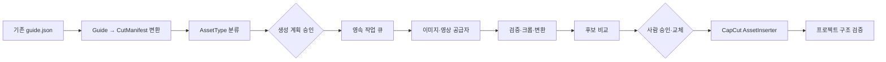
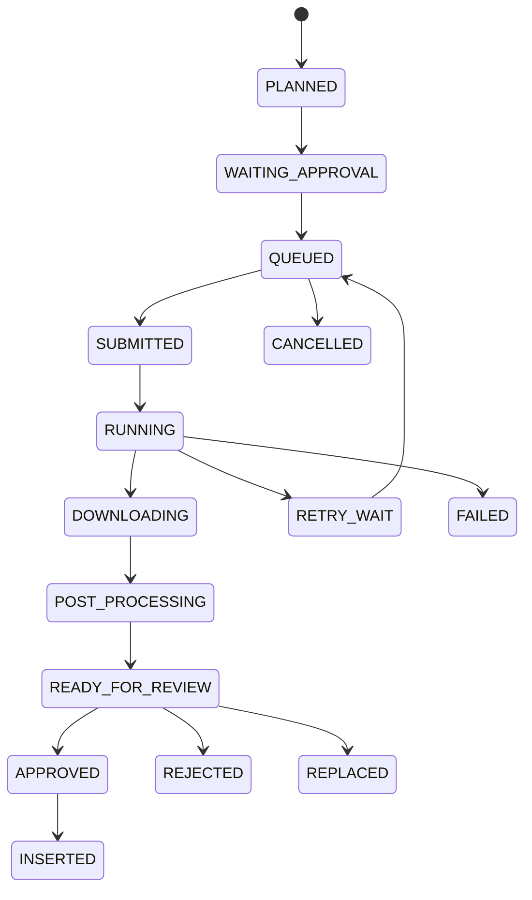

# 생성형 에셋 확장 설계

작성일: 2026-07-27  
검토 범위: 개인 자동화판의 확장 지점과 2026-07-27 구현 기준선.

문서 역할: 이 문서는 생성형 에셋의 기술 확장 지점을 설명한다. 승인된 제품 정책과
예산은 [`product-decisions.md`](product-decisions.md), 단계별 PR은
[`implementation-roadmap.md`](implementation-roadmap.md)를 우선한다.

2026-07-27 제품 결정 반영:

- 후보는 컷당 1개, 자동 재생성은 1회다.
- 사실성이 중요한 컷은 초기에는 `MANUAL_REQUIRED`다.
- 모든 유료 생성은 실행 전에 사람 승인을 받으며 자동 유료 공급자 폴백은 없다.
- 이미지 첫 adapter는 OpenAI `gpt-image-2`를 대상으로 한다.
- 영상 첫 평가 adapter는 Google `gemini-omni-flash-preview`다. preview이므로
  production 고정은 실측 후 결정한다.
- CapCut 내보내기는 `PrepareExport`와 `CommitExport`로 나눈다.
- Qwen 최종 검수는 `ReviewReport`만 만들고 결과물을 수정하지 못한다.

## 1. 사실, 제안, 추가 확인의 구분

이 문서에서 다음 표기를 사용한다.

- **[확인]** 현재 저장소 코드에서 직접 확인한 사실
- **[제안]** 향후 구현을 위한 권장 설계
- **[확인 필요]** 코드만으로 결정할 수 없거나 실제 서비스·CapCut에서 검증해야 하는 사항

현재 구현 상태는 다음과 같다.

- **[확인]** `shortly/generate/image_reco.py`는 `guide["segments"]`에 `image_suggestions`, `media_suggestions`, `effect_suggestions` 문자열 목록을 추가한다.
- **[확인]** `shortly/generate/capcut_export.py`는 위 추천 문자열을 사용하지만 실제 추천 이미지를 내려받거나 생성하지 않는다. 직접 내보내기에서는 자리표시자 컷 이미지를 만들 수 있다.
- **[확인]** `shortly/core/domain/assets.py`와
  `shortly/core/use_cases/build_cut_manifest.py`에 versioned `CutManifest`,
  `AssetType`, 결정론적 기본 분류가 구현됐다.
- **[확인]** `shortly/apps/personal/automation/`에 SQLite 작업·승인·사용량·선택
  기록, 예산 gate, 결정론적 작업 그래프가 구현됐다.
- **[확인]** 개인판에 OpenAI `gpt-image-2` 이미지 adapter와 Google
  `gemini-omni-flash-preview` 영상 adapter가 구현됐다. 자동 테스트는 fake
  provider만 실제 실행하며 유료 API는 호출하지 않는다.
- **[확인]** 생성 이미지 원본 보존과 1080×1920 JPEG 크롭, 단일 후보 자동 선택,
  수동 재선택 기록을 지원한다.
- **[확인]** `/personal/assets` UI에서 컷 유형 변경, 예상 비용 확인, 일회용 승인,
  생성 실행, 기술/Qwen 검수, CapCut prepare/commit을 제공한다.
- **[확인]** 현재 웹 작업 상태는 `shortly/web/app.py`의 프로세스 메모리 딕셔너리·스레드·큐에만 존재하며 재시작 복구, TTL 정리, 취소를 제공하지 않는다.
- **[확인]** 직접 CapCut 내보내기는 템플릿 프로젝트를 복사해 복사본의 JSON과 프로젝트 ID를 수정하고 CapCut 루트 메타데이터에 등록한다.
- **[확인 필요]** 실제 키를 사용한 공급자별 1회 smoke test와 실제 사용 중인 CapCut
  버전에서 이미지·영상 트랙을 여는 E2E는 아직 수동 검증이 필요하다.
- **[확인 필요]** Gemini Omni Flash는 preview이며 현재 adapter는 공식 예제와 같은
  inline base64 응답만 지원한다. URI delivery가 필요해지면 별도 다운로드 상태
  머신을 추가해야 한다.

## 2. 권장 흐름

LLM 판단과 결정론적 처리를 분리한다. LLM은 분류, 검색어·프롬프트 초안, 후보 의미 평가에만 사용하고 파일 검증, 비율 변환, 상태 전이, 재시도, 예산 제한, CapCut 삽입은 일반 코드가 담당한다.



## 3. 데이터 모델

### 3.1 AssetType

**[제안]** `shortly/core/domain/assets.py`에 문자열 enum으로 둔다. 초기 모듈형 단일 패키지 구조를 먼저 적용하므로 별도 배포 패키지를 전제로 하지 않는다.

```text
REAL_PHOTO
STOCK_IMAGE
GENERATED_IMAGE
GENERATED_VIDEO
MEME
SCREENSHOT
MANUAL_REQUIRED
NONE
```

`AssetType` 하나에 모든 의미를 넣지 않는다. 다음 축을 별도 필드로 둔다.

- `MediaKind`: image, video, audio
- `UsageRole`: background, overlay, evidence, product
- `RightsStatus`: unknown, licensed, generated, restricted

### 3.2 CutManifest

**[제안]** `CutManifest`는 공통 도메인 계약으로 두되, 자동 생성 실행과 공급자 정보는 개인판 모듈이 소유한다. 팀판도 향후 명세를 읽거나 수동 에셋을 연결할 수 있어야 하기 때문이다.

상위 필드:

```text
manifest_id, schema_version, project_id, guide_revision
aspect_ratio, target_width, target_height, fps
cuts[], created_at, updated_at
```

각 `CutSpec`:

```text
cut_id, segment_id, order
start_ms, duration_ms
narration, caption
visual_intent, required_subjects, prohibited_content
asset_type, media_kind, usage_role, rights_status
source_query, generation_prompt, negative_prompt
target_crop, safe_area
candidates[], selected_candidate_id
decision_source, confidence, rationale
approval_status, reviewer_note
```

각 `AssetCandidate`:

```text
candidate_id, provider, provider_job_id
source_uri 또는 local_path
mime_type, width, height, duration_ms
prompt_revision, seed, model
provenance, checksum
quality_scores, moderation_status
cost_record_id, status, error
```

ID는 재실행해도 같은 컷을 식별할 수 있어야 한다. 배열 인덱스를 영속 ID로 사용하지 않는다.

### 3.3 현재 데이터와의 연결

- **[확인]** 현재 변환 입력은 `guide.json`의 `segments`이며, 각 세그먼트에는 대사·자막·시간·SFX·추천 정보가 들어간다.
- **[제안]** `GuideToCutManifest` 변환기를 별도 use case로 만들고 기존 `guide.json`을 변경하지 않는다.
- **[제안]** 첫 스키마는 기존 세그먼트 한 개를 컷 한 개로 변환하되, 이후 세그먼트 안의 `cut_count`를 여러 `CutSpec`으로 확장할 수 있게 한다.
- **[확인 필요]** 실제 편집에서는 세그먼트와 컷이 1:1인지, 한 대사 안에서 이미지가 몇 번 바뀌는지가 채널별로 다르므로 표본 프로젝트로 규칙을 정해야 한다.

## 4. 구성요소와 위치

| 구성요소 | 권장 위치 | 현재 코드 연결점 | 상태 |
|---|---|---|---|
| `AssetType`, `CutManifest` | `shortly/core/domain/assets.py` | `guide["segments"]` | 제안 |
| Guide 변환기 | `shortly/core/use_cases/build_cut_manifest.py` | `shortly/generate/guide.py`, `image_reco.py` 출력 | 제안 |
| 이미지 생성 포트 | `shortly/core/ports/assets.py` | 없음 | 제안 |
| 영상 생성 포트 | `shortly/core/ports/assets.py` | 없음 | 제안 |
| OpenAI 어댑터 | `shortly/personal/assets/providers/openai.py` | 현 LLM용 OpenAI 어댑터와 별개 | 제안 |
| Google 어댑터 | `shortly/personal/assets/providers/google.py` | 현 `shortly/llm/gemini.py`와 별개 | 제안 |
| 작업 큐·상태 저장 | `shortly/personal/jobs/` | 현 웹 인메모리 jobs를 재사용하지 않음 | 제안 |
| 비용·사용량 | `shortly/personal/usage/` | 없음 | 제안 |
| 이미지 후처리 | `shortly/personal/media/image_pipeline.py` | Pillow는 이미 사용 중 | 제안 |
| 후보 검수기 | `shortly/personal/assets/review.py` | 없음 | 제안 |
| 승인·교체 UI | `shortly/apps/personal/` | 현 단일 정적 UI를 단계적으로 분리 | 제안 |
| CapCut 삽입기 | `shortly/integrations/capcut/assets.py` | `shortly/generate/capcut_export.py` | 제안 |
| 작업 그래프 | `shortly/personal/orchestration/` | 현 `service.py` 순차 흐름 | 제안 |

공통 코어는 공급자 SDK, Pillow, FFmpeg를 직접 import하지 않는다. 포트의 요청·응답 데이터와 파일 참조만 소유한다.

## 5. 공급자 포트

**[제안]** 이미지와 영상은 공통 타입을 공유하되 비동기 특성이 달라 포트를 분리한다.

```python
class ImageGenerationProvider(Protocol):
    capabilities: ImageCapabilities
    def submit(self, request: ImageGenerationRequest) -> GenerationSubmission: ...
    def get_status(self, job_id: str) -> GenerationStatus: ...
    def fetch_result(self, job_id: str) -> GenerationResult: ...
    def cancel(self, job_id: str) -> None: ...

class VideoGenerationProvider(Protocol):
    capabilities: VideoCapabilities
    def submit(self, request: VideoGenerationRequest) -> GenerationSubmission: ...
    def get_status(self, job_id: str) -> GenerationStatus: ...
    def fetch_result(self, job_id: str) -> GenerationResult: ...
    def cancel(self, job_id: str) -> None: ...
```

capability에는 지원 비율, 크기·길이, 참조 이미지, seed, negative prompt, 오디오 생성 여부와 가격 단위를 둔다. 모델명 문자열만 보고 공급자를 고르지 않는다.

오류는 최소한 인증 실패, 잘못된 요청, moderation 거절, rate limit, 일시 장애, quota·예산 초과, artifact 다운로드 실패로 정규화한다. 다운로드 실패는 공급자 작업을 다시 생성하지 않고 기존 job ID로 재시도한다.

**[확인]** 2026-07-27 공식 문서 기준 첫 평가 대상은 OpenAI `gpt-image-2`와 Google
`gemini-omni-flash-preview`다. 후자는 preview이고 9:16·image-to-video를 지원한다.
API 응답 보존 정책, snapshot과 가격 단위는 구현 시점에 다시 확인해야 한다.

## 6. 작업 큐, 재시도, 비용

**[확인]** 현재 저장소에는 일반 목적 영속 큐나 데이터베이스가 없다.

**[제안]** 첫 개인판은 별도 브로커보다 SQLite 기반 로컬 저장소로 시작한다. 이는 제안이지 현재 구현 사실이 아니다.



- idempotency key: project + cut + provider + request hash + attempt policy
- `SUBMITTED` 이후에는 공급자 job ID를 먼저 저장한다.
- 재시도는 횟수뿐 아니라 최대 비용과 경과 시간으로 제한한다.
- 예상 비용과 공급자 확정 비용을 분리한다.
- 프로젝트·단계·공급자별 예산과 사람 승인 임계값을 둔다.

권장 `UsageRecord`:

```text
record_id, project_id, cut_id, job_id
provider, model, operation
input_units, output_units, unit_type
estimated_cost, billed_cost, currency
attempt, cached, started_at, completed_at
provider_request_id
```

가격표는 코드 상수가 아니라 출처와 유효일을 포함한 설정으로 관리한다.

## 7. 이미지 후처리와 검수

**[제안]** 원본 생성물은 불변으로 보존하고 후처리 결과를 새 artifact로 만든다.

결정론적 검증:

- MIME·파일 서명·디코딩 가능 여부
- 원본 해상도, 종횡비, 길이
- EXIF 방향과 알파 처리
- 9:16 목표 캔버스의 crop, pad, resize
- safe area 침범과 텍스트 잘림
- checksum, provenance, 중복 perceptual hash

의미 기반 후보 평가는 자동 승인 근거가 아니라 정렬 신호로만 사용한다. UI는 후보 나란히 보기, 원본·후처리 비교, 재생성, 로컬 파일 교체, crop 수정, 승인·거절 이유를 제공한다. 선택 이력은 바로 학습시키지 않고 `SelectionEvent`로 축적한다.

## 8. CapCut 삽입기

- **[확인]** `shortly/generate/capcut_export.py`는 중립 `capcut-draft-v0` 생성과 실제 템플릿 복제·등록이라는 서로 다른 책임을 한 파일에 가진다.
- **[확인]** 템플릿 복제 경로는 복사본을 수정하지만, 공식 스키마 버전 검증·원자적 트랜잭션·실패 시 전체 롤백은 없다.
- **[제안]** `AssetInserter`는 승인된 `CutManifest`와 후보만 입력받고, 현재 exporter 앞에 별도 경계로 추가한다.
- **[제안]** 임시 디렉터리에서 파일 복사와 JSON 변경을 완료하고 구조 검증 후 최종 프로젝트명으로 원자적 이동·등록한다.
- **[제안]** 원본 템플릿은 절대 수정하지 않고 삽입 manifest와 생성·복사 파일 목록을 남긴다.
- **[확인 필요]** CapCut 버전별 material 필드, 이미지·영상 트랙 예시, Windows/macOS 프로젝트 루트는 익명화된 실제 fixture로 검증해야 한다.

현재 추천 문구만 있고 실제 파일이 없는 컷은 계속 `MANUAL_REQUIRED`로 내보내는 호환 경로를 유지한다.

## 9. 작업 그래프와 멀티 에이전트

**[제안]** 처음부터 자유롭게 다음 행동을 정하는 자율 에이전트를 두지 않는다. 저장된 입력·출력 계약을 가진 결정론적 DAG를 우선한다.

```text
topic_select
→ topic_review [approval]
→ research
→ script_draft
→ fact_check
→ script_review [approval]
→ cut_plan
→ asset_type_classification
→ asset_plan_review [approval]
→ asset_generation*
→ post_process*
→ candidate_review [approval]
→ capcut_export
→ final_validation
```

각 노드는 입력·출력 스키마, side effect 여부, 모델 capability, timeout·retry·budget, cache·idempotency, 사람 개입 조건, 실패 대안을 가진다. 로컬 Qwen과 상용 모델 선택은 작업 성격과 capability 정책으로 결정하고, 그래프의 순서는 일반 코드가 통제한다.

## 10. 권장안과 차선책

| 안 | 장점 | 단점 | 판단 |
|---|---|---|---|
| 버전 있는 manifest + 영속 상태 머신 + 공급자 포트 | 재시작 복구, 중복 과금 방지, 공급자 교체, 사람 검수에 적합 | 초기 모델·테스트 설계가 필요 | **권장** |
| `guide.json` 확장 + 로컬 JSON 상태 + 동기 공급자 한 개 | 빠르게 시제품 가능, 새 DB 없음 | 스키마 결합, 동시성·복구·비용 관리가 약함 | 제한된 PoC 차선책 |
| 기존 `service.py`에 생성 API를 직접 추가 | 파일 수가 적음 | 대형 함수 결합과 팀판 의존성 누출을 악화 | 비권장 |

현재 저장소에는 DB가 없으므로 SQLite 도입도 첫 manifest 계약이 안정된 뒤 진행한다. 공급자 API를 먼저 붙이는 순서는 권장하지 않는다.

## 11. 단계별 개인판 확장

### 단계 A: Manifest와 수동 검토

- 기존 `guide`를 `CutManifest`로 변환한다.
- 규칙 기반 `AssetType` 기본값과 사용자 수정 UI를 제공한다.
- 로컬 수동 에셋을 컷에 연결하고 승인 상태를 저장한다.
- 외부 생성 API는 호출하지 않는다.

완료 조건: 재실행 후 모든 컷 ID, 선택 파일, 승인 상태가 복원되고 기존 `guide.json`과 현 CapCut 출력은 변하지 않는다.

### 단계 B: 이미지 공급자 한 개

- fake 공급자로 계약 테스트를 먼저 만든다.
- 실제 이미지 공급자 하나, 작업 상태·idempotency·비용 기록·후처리를 연결한다.
- 승인된 결과만 CapCut 삽입기에 전달한다.

완료 조건: 실패·재시작·재시도에도 중복 과금과 중복 삽입이 없다.

### 단계 C: 다중 이미지 공급자와 영상

- capability·비용 정책으로 공급자를 선택한다.
- 영상 polling·취소·다운로드를 추가한다.
- 공급자별 장애 폴백은 명시적 정책으로만 수행한다.

### 단계 D: 작업 그래프

- 조사부터 최종 검수까지 저장 가능한 노드로 연결한다.
- 사람 승인, 예산, 재시도를 그래프 실행기가 통제한다.
- 기존 `service.py` 흐름은 호환 경로로 유지한다.

### 단계 E: 선택 기록 활용

- 채널별 `SelectionEvent`를 분석한다.
- 규칙·프롬프트·후보 정렬을 개선한다.
- 충분한 표본과 오프라인 평가 전에는 자동 학습·배포하지 않는다.

## 12. 확정 사항과 남은 결정

확정:

- `CutManifest` 계약은 공통 코어에 두고 팀판은 인터페이스만 포함한다.
- 개인판 데이터는 팀판과 분리하고 선택 기록은 영구 보존한다.
- 모든 유료 생성 전에 승인하며 생성 실패는 `MANUAL_REQUIRED`로 전환한다.
- 초기 작업 그래프는 자유 행동형 에이전트가 아니라 결정론적 DAG다.
- 로컬 Qwen 최종 검수는 읽기 전용이다.

남은 결정:

1. 세그먼트와 실제 편집 컷의 관계 및 컷 분할 기준
2. 개인 작업 상태의 SQLite 대 프로젝트별 JSON
3. 생성 model alias/snapshot과 가격표 유효일
4. 원본·후보·선택 기록의 backup·export·삭제 방식
5. 지원할 CapCut 버전과 익명 template
6. 외부 모델로 전송 가능한 데이터 범위

## 13. 요약

- 가장 먼저 할 일은 공급자 연결이 아니라 `guide → CutManifest` 계약과 golden fixture를 만드는 것이다.
- 지금 건드리면 위험한 부분은 `shortly/generate/capcut_export.py`의 템플릿 복제, ID 재생성, TTS 타이밍, 루트 등록 로직이다.
- 개인 자동화판의 첫 구현은 규칙 기반 분류와 수동 검토·교체까지이며 외부 이미지·영상 생성 호출은 포함하지 않는다.
- 주요 기술 부채는 단일 `service.py`, 무스키마 dict, 인메모리 웹 작업, CapCut 비공식 스키마, 공급자별 오류·비용 계약 부재다.
- 익명화된 실제 CapCut 프로젝트와 채널별 컷 분할 사례 없이는 삽입기 계약을 확정할 수 없다.
