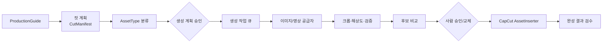
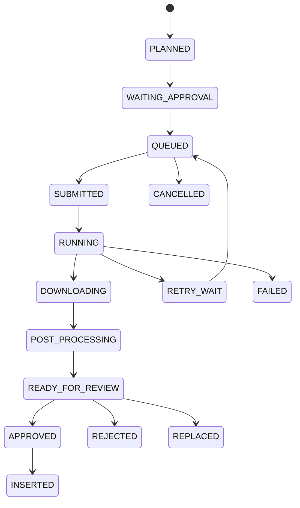

# 생성형 에셋 확장 설계

작성일: 2026-07-27  
범위: 개인 자동화판의 확장 지점 설계. 이미지·영상 생성 기능 자체는 구현하지 않는다.

## 1. 설계 방향

첫 단계는 “에이전트가 알아서 끝까지 생성”이 아니라, 기존 `guide.json`에서 명시적 `CutManifest`를 만들고 각 단계를 상태가 보이는 작업 그래프로 실행하는 것이다.

LLM은 분류, 검색어/프롬프트 작성, 후보 평가처럼 판단이 필요한 노드에만 사용한다. 파일 검증, 크롭, 해상도 변환, 재시도 횟수, 비용 제한, CapCut 삽입, 승인 게이트는 결정론적 코드로 처리한다.



## 2. 핵심 데이터 모델

### AssetType

코어 도메인에 문자열 enum으로 둔다.

```text
REAL_PHOTO        실제 촬영/제품/인물 사진
STOCK_IMAGE       라이선스가 확인된 스톡 이미지
GENERATED_IMAGE   생성형 이미지
GENERATED_VIDEO   생성형 영상
MEME              밈/반응 이미지
SCREENSHOT        웹/앱/자료 화면
MANUAL_REQUIRED   사람이 직접 넣어야 하는 자산
NONE              자산 없이 텍스트/배경만 사용
```

`AssetType`은 “어디서 얻는가”를 뜻하고, `MediaKind`(image/video/audio), `UsageRole`(background/overlay/evidence/product), `RightsStatus`는 별도 필드로 둔다. 하나의 enum에 모든 의미를 섞지 않는다.

### CutManifest

위치: 공통 코어의 `domain/assets.py` 후보. 팀판도 추천 표시나 수동 자산 연결에 쓸 수 있으므로 개인 전용으로 두지 않는다.

권장 상위 필드:

```text
manifest_id, schema_version, project_id, guide_revision
aspect_ratio, target_width, target_height, fps
cuts[], created_at, updated_at
```

각 `CutSpec`:

```text
cut_id, segment_id, order
start_ms, duration_ms
narration, caption
visual_intent, required_subjects, prohibited_content
asset_type, media_kind, usage_role
source_query, generation_prompt, negative_prompt
target_crop, safe_area
candidates[], selected_candidate_id
decision_source, confidence, rationale
approval_status, reviewer_note
```

각 `AssetCandidate`:

```text
candidate_id, provider, provider_job_id
source_uri 또는 local_path
mime_type, width, height, duration_ms
prompt_revision, seed, model
rights/provenance, checksum
quality_scores, moderation_status
cost_record_id, status, error
```

모든 ID는 재실행해도 동일 컷을 식별할 수 있어야 한다. 배열 인덱스를 식별자로 쓰지 않는다.

## 3. 구성요소 위치와 인터페이스

| 구성요소 | 권장 위치 | 책임 |
|---|---|---|
| `AssetType`, `CutManifest` | 공통 core/domain | 앱·공급자와 무관한 계약 |
| 가이드→컷 변환기 | core/use_cases 또는 personal/assets/planning | 기존 guide를 manifest로 변환 |
| AssetType 분류기 | personal/assets/classification | 규칙 우선, 필요 시 LLM |
| 이미지 생성 포트 | core/ports/assets | 요청/작업/결과 계약 |
| 영상 생성 포트 | core/ports/assets | 비동기 생성/상태 조회/취소 |
| OpenAI/Google 어댑터 | providers/assets/openai, google | 공급자 SDK와 오류/사용량 변환 |
| 생성 작업 큐 | personal/jobs | idempotency, 동시성, 우선순위 |
| 상태/재시도 저장 | personal/jobs/repository | 영속 상태머신과 backoff |
| 비용/사용량 기록 | core domain + personal persistence | 공급자 사용량을 정규화 |
| 이미지 후처리 | personal/media/image_pipeline | crop/resize/pad/format |
| CapCut AssetInserter | capcut 패키지 | 승인된 artifact를 컷에 배치 |
| 후보 검수기 | personal/assets/review | 기술 검증 + 의미 평가 |
| 승인·교체 UI | apps/personal | 후보 비교, 업로드, 선택, 이력 |
| 작업 그래프 | personal/orchestration | 결정론적 DAG 실행과 승인 게이트 |

공통 core에는 공급자 SDK나 Pillow/FFmpeg를 import하지 않는다. 포트의 입력/출력은 도메인 모델과 파일 참조만 사용한다.

## 4. 공급자 인터페이스

이미지와 영상은 공통 기반 타입을 공유하되 억지로 하나의 메서드로 합치지 않는다. 영상은 대개 비동기 polling이 필요하기 때문이다.

```python
class ImageGenerationProvider(Protocol):
    capabilities: ImageCapabilities
    def generate(self, request: ImageGenerationRequest) -> GenerationSubmission: ...
    def get_result(self, job_id: str) -> GenerationResult: ...
    def cancel(self, job_id: str) -> None: ...

class VideoGenerationProvider(Protocol):
    capabilities: VideoCapabilities
    def submit(self, request: VideoGenerationRequest) -> GenerationSubmission: ...
    def get_status(self, job_id: str) -> GenerationStatus: ...
    def fetch_result(self, job_id: str) -> GenerationResult: ...
    def cancel(self, job_id: str) -> None: ...
```

capability에는 지원 비율, 최대 크기/길이, 참조 이미지, seed, negative prompt, 오디오 생성, 가격 단위가 포함된다. 공급자 선택기는 “모델명 문자열”이 아니라 capability와 정책을 보고 선택한다.

오류는 최소한 다음으로 정규화한다.

- `AuthenticationError`: 재시도 금지, 사용자 조치
- `InvalidRequestError`: 프롬프트/크기 수정 후 재제출
- `ModerationRejected`: 자동 폴백 여부를 정책으로 결정
- `RateLimited`: backoff 재시도
- `TransientProviderError`: 제한 횟수 재시도
- `QuotaOrBudgetExceeded`: 즉시 중단 및 승인 요청
- `ArtifactDownloadError`: 생성 job을 다시 만들지 말고 다운로드만 재시도

## 5. 작업 큐와 상태 머신

초기에는 외부 브로커보다 SQLite 기반 로컬 큐가 적절하다. 현재 단일 사용자 로컬 앱이고, 재시작 후 복구와 트랜잭션이 필요하기 때문이다. 다만 실제 저장 기술은 구현 전 결정한다.

권장 상태:



각 작업에는 `idempotency_key = project + cut + provider + request_hash + attempt_policy`를 둔다. 앱 재시작 후 `SUBMITTED/RUNNING` 작업은 공급자 job ID로 재조회하며, 같은 생성 요청을 무조건 다시 과금하지 않는다.

재시도 정책은 공급자 오류 유형별로 다르게 하고, 최대 횟수뿐 아니라 최대 비용과 최대 경과 시간도 제한한다.

## 6. 비용 및 사용량

`UsageRecord` 권장 필드:

```text
record_id, project_id, cut_id, job_id
provider, model, operation
input_units, output_units, unit_type
estimated_cost, billed_cost, currency
attempt, cached, started_at, completed_at
provider_request_id
```

비용은 제출 전 예상치와 완료 후 실제치를 분리한다. 프로젝트/단계/공급자별 예산을 두고 다음 게이트를 제공한다.

- 단일 생성 비용 한도
- 컷별 후보 수 한도
- 프로젝트 총예산
- 자동 재시도 예산
- 예산 초과 전 사람 승인

가격표는 코드 상수가 아니라 날짜와 출처가 있는 provider pricing 설정으로 관리해야 한다.

## 7. 이미지 후처리

위치: 개인 media pipeline. 생성 어댑터 안에 넣지 않는다.

단계:

1. MIME/파일 서명/디코딩 검증
2. 해상도와 종횡비 기록
3. 목표 9:16 캔버스에 맞춘 crop/pad 전략 결정
4. 얼굴/주요 피사체와 자막 safe area를 고려한 crop
5. 색공간, 방향(EXIF), 알파 처리
6. 목표 해상도 변환과 품질 설정
7. checksum과 파생 관계 저장
8. 썸네일/비교용 preview 생성

원본 생성물은 불변으로 보존하고, 후처리 결과를 새 artifact로 만든다. 사람의 수동 crop도 동일한 파생 이력으로 기록한다.

## 8. CapCut 에셋 삽입기

`AssetInserter`는 현재 `capcut_export.py`의 프로젝트 복제/등록 로직 위에 별도 계층으로 둔다.

입력:

- 승인된 `CutManifest`
- 선택된 `AssetCandidate`
- 타임라인 시간 범위
- crop/transform/animation 명세

출력:

- 삽입된 material/segment ID
- 생성/복사된 파일 목록
- 프로젝트 백업 위치
- 검증 결과

필수 안전장치:

- 원본 템플릿 프로젝트 직접 수정 금지
- 임시 디렉터리에서 생성 후 원자적 rename
- 참조 무결성 검사
- 삽입 전/후 manifest
- 재실행 시 중복 트랙 방지
- 승인되지 않은 후보 삽입 금지

현재 추천 문구를 텍스트 트랙으로 넣는 동작은 `MANUAL_REQUIRED` 폴백으로 계속 사용할 수 있다.

## 9. 후보 비교와 사람 검수

검수는 두 층으로 나눈다.

### 결정론적 검사

- 파일 열기 가능, 크기/비율/길이
- 검은 프레임/빈 이미지/손상
- 워터마크 또는 정책상 금지 메타데이터
- 중복 이미지 perceptual hash
- 안전 영역 위반
- 생성 요청과 artifact provenance 연결

### 의미 기반 평가

- 대사/컷 의도와의 적합도
- 채널 스타일 적합도
- 인물/브랜드/제품 왜곡
- 텍스트 렌더링 오류
- 사실 전달 컷에서의 오해 가능성

LLM/비전 평가 점수는 자동 승인 근거가 아니라 정렬 신호로 우선 사용한다. 사람 UI는 후보 나란히 보기, 원본/후처리 비교, 재생성, 프롬프트 수정, 로컬 파일 교체, crop 수정, 승인/거절 사유를 제공한다.

선택 기록은 다음 추천에 쓰기 위해 `SelectionEvent`로 보존한다.

```text
channel_id, project_id, cut_id
candidates 요약, selected_id
action(approve/replace/reject/regenerate)
reason_tags, free_note
classifier_version, reviewer, timestamp
```

초기에는 이를 곧바로 모델 학습에 쓰지 말고 규칙/프롬프트 평가 데이터로 축적한다.

## 10. 작업 그래프와 역할별 에이전트

권장 DAG:

```text
topic_select
→ topic_review [approval]
→ research
→ script_draft
→ fact_check
→ script_review [approval]
→ cut_plan
→ asset_type_classification
→ asset_plan_review [approval]
→ asset_generation*
→ post_process*
→ candidate_review [approval]
→ capcut_export
→ final_validation
```

각 노드는 다음 계약을 가진다.

- 명시적 입력/출력 스키마
- side effect 여부
- 선택할 model capability
- timeout/retry/budget
- cache/idempotency
- 사람이 개입할 조건
- 실패 시 폴백

“에이전트 역할”은 처음에는 노드별 프롬프트/도구 정책의 이름이다. 에이전트끼리 자유 대화하거나 임의로 다음 단계를 만드는 구조는 나중 문제다. 그래프 실행기가 순서, 예산, 승인, 재시도를 통제한다.

모델 라우팅 예:

| 작업 | 우선 모델 성격 | 폴백 |
|---|---|---|
| 간단 분류/정규화 | 로컬 Qwen 저비용 | 상용 소형 |
| 채널 비전 분석 | 비전 지원 로컬/상용 | 수동 검토 |
| 사실 조사 요약 | 검색 근거를 다루는 상용 모델 | 규칙 기반 원문 묶음 |
| 고품질 대본 | 상용 고성능 | 다른 상용 공급자 |
| 이미지 후보 평가 | 비전 모델 | 사람 정렬 |
| 이미지/영상 생성 | capability/가격 기반 | 다른 공급자 또는 manual |

## 11. 단계별 개인 확장 로드맵

### 1단계: Manifest와 수동 검토

- 기존 `guide`를 `CutManifest`로 변환한다.
- AssetType 규칙 분류와 UI 수정을 제공한다.
- 로컬 자산을 컷에 연결하고 승인 상태를 저장한다.
- 외부 생성 API는 호출하지 않는다.

완료 조건: 한 프로젝트의 모든 컷이 명시적 상태와 선택 자산을 가지고, 재시작 후 복원된다.

### 2단계: 이미지 생성 한 공급자

- `ImageGenerationProvider` fake와 실제 어댑터 하나.
- 큐, idempotency, 비용, 다운로드, 후처리, 후보 비교.
- 승인 후에만 CapCut에 삽입.

완료 조건: 실패/재시작/중복 클릭에도 중복 과금과 중복 삽입이 없다.

### 3단계: 공급자 라우팅과 영상

- Google/OpenAI 등 두 번째 이미지 공급자.
- 영상 provider 인터페이스와 polling.
- capability/비용/폴백 정책.

### 4단계: 작업 그래프

- 조사부터 최종 검수까지 노드화.
- 사람 승인 게이트, 프로젝트 예산, 재실행.
- 기존 `service.py` 흐름은 호환 그래프 또는 legacy 경로로 유지.

### 5단계: 선택 기록 활용

- 채널별 선택 이벤트 분석.
- 규칙/프롬프트 추천 개선.
- 충분한 데이터와 평가셋이 생긴 뒤에만 학습/랭킹 모델 검토.

## 12. 당장 피해야 할 설계

- 생성 공급자 응답 dict를 그대로 `guide.json`에 저장
- CapCut 삽입과 생성 API 호출을 하나의 함수로 묶기
- 실패할 때마다 job ID를 버리고 무조건 재생성
- LLM이 비용/재시도/승인 여부를 자유롭게 결정
- 승인 전 원본 CapCut 프로젝트를 수정
- 파일 경로만 저장하고 checksum/provenance를 저장하지 않기
- 팀판 core가 개인용 공급자 SDK를 import하도록 만들기

## 13. 추가 결정 사항

- 개인 작업 상태 저장소를 SQLite로 시작할지
- 원본 생성 에셋의 보존 기간과 저장 한도
- 첫 이미지/영상 공급자와 예산
- 채널별 저작권·인물·브랜드 정책
- 자동 승인 허용 범위
- CapCut 삽입 후 되돌리기 UX
- 작업 그래프의 동시 생성 개수와 GPU/API 자원 우선순위

