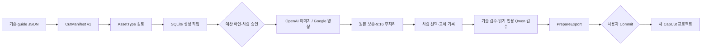

# 개인 자동 생성 파이프라인 구현 보고서

작성일: 2026-07-27

대상: `agent/personal-asset-pipeline`

범위: 포터블 개선을 제외한 개인 자동 생성 기준선

## 1. 구현 결과

기존 guide와 캡컷 내보내기 동작은 유지하면서 개인판에만 다음 흐름을 추가했다.



구현된 항목:

- 공통 도메인의 `AssetType`, `MediaKind`, `CutManifest`, `CutSpec`,
  `AssetCandidate`와 JSON 직렬화
- 기존 guide를 변경하지 않는 컷 명세 변환 및 보수적 사실성 분류
- 사실성이 중요한 컷의 자동 생성 차단과 `MANUAL_REQUIRED` 처리
- SQLite 기반 manifest, job, 승인, 사용량, 선택 이력, workflow 상태
- 중복 요청 방지용 idempotency key와 일회용 승인 토큰
- 편당 이미지 1달러, 영상 5달러, 일 10달러, 월 50달러의 조정 가능한 초기 상한
- 기본 후보 1개, 최초 생성 후 재생성 1회까지의 정책
- OpenAI Images API의 `gpt-image-2` adapter
- Google Gen AI SDK의 `gemini-omni-flash-preview` 9:16 영상 adapter
- 네트워크·비용 없이 검증하는 fake 이미지·영상 provider
- 이미지 원본 보존, EXIF 반영, 1080×1920 중앙 crop 및 JPEG 준비본
- 단일 후보 자동 선택과 사람이 바꾼 선택의 영구 이력
- 선택 asset을 기존 캡컷 컷 자리에 복사하는 image/video material 연결
- CapCut 변경 전 검증하는 `PrepareExport`와 명시적 `CommitExport`
- 기술 검수와 mutation port를 받지 않는 로컬 Qwen `ReviewReport`
- 명시적인 전이만 허용하는 결정론적 workflow graph
- 개인판 전용 API와 `/personal/assets` 검토 화면
- 팀 artifact에서 `shortly/apps/personal`과 개인 의존성을 제외하는 기존 경계 유지

## 2. 주요 코드 위치

| 영역 | 위치 |
|---|---|
| 공통 asset 계약 | `shortly/core/domain/assets.py` |
| guide 변환·기본 분류 | `shortly/core/use_cases/build_cut_manifest.py` |
| 공급자 port | `shortly/core/ports/assets.py` |
| SQLite 저장소·예산 | `shortly/apps/personal/automation/store.py`, `budget.py` |
| 승인 생성 실행 | `shortly/apps/personal/automation/executor.py` |
| 작업 그래프 | `shortly/apps/personal/automation/graph.py` |
| Qwen/기술 검수 | `shortly/apps/personal/automation/review.py` |
| CapCut 2단계 내보내기 | `shortly/apps/personal/automation/capcut_assets.py` |
| OpenAI/Google adapter | `shortly/apps/personal/assets/` |
| 개인 API·UI | `shortly/apps/personal/automation/api.py`, `shortly/apps/personal/static/assets.html` |

## 3. 실행과 설정

```powershell
python -m pip install -r requirements.txt -r requirements-personal.txt
python -m shortly.apps.personal.launcher
```

기존 설정 화면에서 API 키를 저장하고
`http://localhost:8756/personal/assets`를 연다. 기존 guide JSON을 붙여 넣어
컷 명세를 만든 뒤 유형을 확인한다. `generated_image` 또는 `generated_video`인
컷만 비용 확인·승인·실행 버튼이 나타난다.

개인 자동화 설정은 `.env.example`의 `SHORTLY_IMAGE_MODEL`,
`SHORTLY_VIDEO_MODEL`, `SHORTLY_*_BUDGET_*`,
`SHORTLY_IMAGE_ESTIMATED_COST_USD`, `SHORTLY_VIDEO_ESTIMATED_COST_USD`,
`SHORTLY_MAX_ASSET_REGENERATIONS`, `SHORTLY_ASSET_CANDIDATES`를 사용한다.
키 값은 SQLite나 manifest에 기록하지 않는다.

## 4. 검증 결과

- 앱 내장 Python 전체 `unittest`: 63개 통과
- 기본 검증 Python: 51개 통과, FastAPI 미설치에 따른 12개 정상 skip
- 기존 대본·가이드·중립 CapCut draft golden: 통과
- 팀/개인 route와 provider 경계: 통과
- 팀 artifact에서 개인 source와 Google dependency 제외: 통과
- CutManifest 직렬화·분류·사실성 차단: 통과
- SQLite 재시작 지속성, idempotency, 승인 1회성: 통과
- 예산 초과 시 provider 미호출: 통과
- fake 생성 → 원본 저장 → 1080×1920 준비본 → 선택 → 비용 기록: 통과
- Qwen 검수의 manifest 불변성: 통과
- CapCut prepare 단계 무변경과 video material 계약: 통과

테스트에서는 외부 API를 호출하지 않았고 비용도 발생하지 않았다.

## 5. 보안·비용 경계

- 유료 provider 호출 전에 편당·일간·월간 상한을 검사한다.
- 승인 토큰은 난수 원문을 한 번만 반환하고 DB에는 SHA-256 hash만 저장한다.
- 토큰은 실행 직전에 소비되며 재사용할 수 없다.
- 자동 유료 fallback은 없다. 실패한 컷은 `MANUAL_REQUIRED`로 전환된다.
- provider 오류는 종류 중심으로 정규화하며 API 키를 오류나 DB에 넣지 않는다.
- 생성 파일과 DB는 개인판의 별도 data/artifact root에 저장된다.
- CapCut commit API는 개인 asset root 안의 prepare plan만 허용한다.
- 개인 자동화 API는 기존 LAN 공유 설정과 무관하게 loopback 요청만 허용한다.

비용 값은 공급자 가격표가 아니라 사용자가 승인하는 예상액이다. API에서 더 낮은
값을 제출해도 서버의 조정 가능한 최소 예상액보다 낮아지지 않는다. 응답이 실제
비용을 제공하지 않으면 그 예상액을 원장에 기록한다. 실제 청구 확인은 공급자
대시보드가 기준이다.

## 6. 아직 필요한 수동 검증

1. 실제 OpenAI 키로 `gpt-image-2`, medium, 1024×1536 이미지 1장을 생성하고
   응답 필드·과금·moderation 오류를 확인한다.
2. 실제 Google 키와 설치된 `google-genai`로
   `gemini-omni-flash-preview` 9:16 영상 1건을 생성한다. preview 사용 가능
   지역, 응답 크기, 비용, 지연 시간을 확인한다.
3. 현재 사용 중인 CapCut Windows 버전에서 생성 이미지와 MP4가 들어간 프로젝트를
   열고 길이, crop, 오디오, project root 등록을 확인한다.
4. 영상이 4MB를 넘어 inline 응답이 부적절하면 Google URI delivery와 files polling을
   별도 PR로 구현한다.
5. 기본 예상 비용과 편당·일간·월간 상한은 실제 5~10편 사용 후 조정한다.

## 7. 공식 API 기준

- OpenAI 공식 문서는 `gpt-image-2`의 Images API, base64 출력, portrait
  `1024x1536`, quality와 format 옵션을 설명한다:
  <https://developers.openai.com/api/docs/guides/image-generation>
- OpenAI 모델 기준:
  <https://developers.openai.com/api/docs/models/gpt-image-2>
- Google 공식 문서는 Gemini Omni Flash가 preview이며
  `gemini-omni-flash-preview`, Interactions API, `aspect_ratio: "9:16"` 및
  base64 MP4 출력을 사용한다고 설명한다:
  <https://ai.google.dev/gemini-api/docs/omni>

## 8. 남은 후속 작업

후순위가 아닌 다음 작업은 실제 공급자와 CapCut의 제한된 수동 smoke test다. 그
결과에 따라 adapter 응답 파싱과 CapCut material fixture만 좁게 수정한다.

다음은 명시적으로 후순위다.

- 팀 포터블 패키지 완성도·자동 업데이트·코드 서명
- Google URI delivery와 대용량 영상 polling
- stock 검색·라이선스 자동 판정
- 후보 수 2개 이상의 자동 ranking
- 완성 MP4의 프레임 단위 멀티모달 검수
- 자율형 멀티 에이전트 및 자동 유료 fallback
