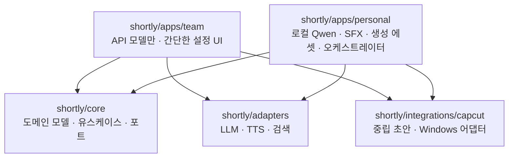

# 팀 배포판·개인 자동화판 분리 계획

작성일: 2026-07-27  
전제: 기존 기능을 삭제하거나 대규모 이동하지 않고, 현재 실행 경로를 유지한 채 점진적으로 분리한다.

문서 역할: 이 문서는 분리 전략과 회귀 위험을 설명한다. 제품 범위와 운영 정책은
[`product-decisions.md`](product-decisions.md), 실제 PR 순서는
[`implementation-roadmap.md`](implementation-roadmap.md)를 우선한다.

## 1. 권장안

권장 구조는 **단일 저장소 + 단계적으로 경계를 만드는 모듈형 단일 패키지 + 팀/개인 별도 엔트리포인트 + 의존성 그룹/빌드 프로파일**이다.

기능 플래그만으로 모든 것을 나누지 않는다. 기능 플래그는 런타임 UX와 점진 전환에 쓰고, 실제 배포물의 의존성/코드 제외는 패키지 경계와 빌드 프로파일이 담당해야 한다.

이 권장안은 이전 문서의 “처음부터 여러 배포 패키지/워크스페이스로 분리”를 보정한다. 현재 `service.py`가 분석, SFX, 생성, CapCut 모듈을 import 시점에 함께 불러오고 `portable/build.py`가 `shortly/` 전체를 복사하므로, 지금 즉시 물리적 멀티 패키지로 나누면 import 파손과 회귀 범위가 너무 크다. 먼저 기존 `shortly` 배포 패키지 안에서 경계를 만들고, 계약 테스트가 확보된 뒤 선택적으로 여러 installable package로 승격하는 순서가 실제 저장소에 적용 가능하다.



첫 마이그레이션에서는 제품 파일을 이동하거나 인터페이스를 추가하지 않는다. 표준 라이브러리 기반 계약/스모크 테스트와 익명 fixture만 추가해 기준선을 고정한다. 그 다음 기존 모듈 옆에 호환 래퍼를 추가하고, 계약 테스트가 생긴 뒤 디렉터리와 배포 패키지를 물리적으로 나눈다.

### 1.1 판정 표기

- **[확인]** 현재 코드·Git·로컬 파일에서 직접 확인한 내용
- **[권장]** 확인된 제약을 바탕으로 한 설계 선택
- **[확인 필요]** 팀의 실제 사용 방식이나 외부 프로그램에서 검증해야 하는 내용

위 권장 구조의 근거인 `service.py` eager import, 소스 전체 복사, 단일 `pyproject.toml`은 **[확인]**이다. 모듈형 단일 패키지를 먼저 거치는 순서는 **[권장]**이며, 장기적으로 여러 installable package가 필요한지는 팀 artifact allowlist와 의존성 검사 뒤 **[확인 필요]**다.

## 2. 기능 분류표

분리 난이도와 회귀 위험은 낮음/중간/높음으로 표시한다.

### 2.1 공통 코어에 유지

| 기능 | 관련 파일 | 현재 의존성 | 결합 | 난이도 / 회귀 | 권장 처리 |
|---|---|---|---|---|---|
| 채널/영상/출력 경로 규칙 | `config.py`, `ingest/youtube.py`, `utils.py` | pathlib, JSON | 설정과 저장이 결합 | 중간 / 높음 | `StoragePaths` 포트와 사용자 데이터 루트를 도입하고 기존 경로를 기본 구현으로 유지 |
| 채널 manifest 및 분석 결과 조립 | `ingest/youtube.py`, `service.py` | yt-dlp, 파일시스템 | 수집과 저장이 결합 | 중간 / 높음 | 수집 포트와 manifest 모델을 분리하되 기존 JSON 스키마 고정 |
| 프로필 집계 | `analyze/style_profile.py`, `layout.py` | LLM 선택적 | 중간 | 중간 / 높음 | 순수 집계와 LLM 합성을 별 함수/포트로 구분 |
| 대본/가이드 도메인 규칙 | `generate/script_gen.py`, `guide.py` | LLM 선택적 | dict 계약에 강결합 | 높음 / 높음 | `Script`, `Guide`, `Segment` 모델을 먼저 추가하고 dict 직렬화 호환 |
| 컷 추천 명세 | `generate/image_reco.py` | LLM 선택적 | 가이드 dict와 결합 | 중간 / 중간 | 향후 `CutManifest`로 승격, 현재 필드 보존 |
| 중립 CapCut 초안 | `generate/capcut_export.py:export_capcut_draft` | JSON | 같은 대형 파일에 묶임 | 중간 / 중간 | 플랫폼 중립 exporter로 먼저 추출, 스키마 버전 유지 |
| AI 공급자 추상화 | `llm/base.py`, `factory.py` | 각 SDK | 기능/비용 정보 부족 | 중간 / 높음 | `TextModelPort`, `VisionModelPort`, capability/usage/error 모델로 확장 |
| TTS 요청/결과 계약 | `tts/typecast.py`, `config.py` | Typecast | CapCut 내부 호출 | 중간 / 높음 | `TtsProvider`와 `AudioArtifact` 도입, Typecast는 어댑터로 유지 |
| 결과 저장/조회 | `service.py`, `utils.py` | 파일시스템 | 유스케이스와 직접 결합 | 중간 / 높음 | `ProjectRepository` 포트와 JSON 파일 구현 추가 |

### 2.2 팀 배포판에 포함

| 기능 | 관련 파일 | 현재 의존성 | 결합 | 난이도 / 회귀 | 권장 처리 |
|---|---|---|---|---|---|
| 웹 UI 및 localhost 서버 | `web/*`, `portable/launcher.py` | FastAPI/Uvicorn | 개인 UI 분기와 공존 | 중간 / 중간 | `team` 엔트리포인트에서 기능 목록을 서버가 제공하고 UI가 이를 따르게 함 |
| 채널 학습 | `service.py`, `ingest/*`, `analyze/*` | yt-dlp, FFmpeg, CV, ASR/OCR, API LLM | 무거운 의존성 | 높음 / 높음 | 팀이 OCR/ASR을 실제 쓰는지 확인 후 core/basic/analysis extra로 분리 |
| 주제/대본 입력과 생성 | `web/*`, `script_gen.py`, `research.py`, `factcheck.py` | API LLM, DDGS | 설정/네트워크와 결합 | 중간 / 높음 | 공급자 설정 검증, 비용 경고, 검색 on/off 명시 |
| 컷/자막/에셋 추천 | `guide.py`, `image_reco.py` | LLM | guide dict 결합 | 중간 / 높음 | 기존 출력 계약을 스냅샷 테스트로 보존 |
| Typecast TTS | `tts/typecast.py`, `capcut_export.py` | Typecast API | CapCut 내보내기 내부 | 중간 / 높음 | 선택 기능으로 표시하고 사전 키 검증/명확한 실패 메시지 추가 |
| Windows CapCut 내보내기 | `capcut_export.py`, `service.py` | 설치된 CapCut/템플릿/폰트 | 매우 강함 | 높음 / 매우 높음 | Windows 전용 어댑터로 격리, 사전 진단과 백업/원자적 쓰기 추가 |
| 포터블 ZIP 배포 | `portable/*` | Windows AMD64 embedded Python/FFmpeg | 소스 전체 복사 | 높음 / 중간 | Windows 11 x64로 제한하고 팀 source·의존성 allowlist 후 ZIP 생성 |

### 2.3 개인 자동화판에만 포함

| 기능 | 관련 파일 | 현재 의존성 | 결합 | 난이도 / 회귀 | 권장 처리 |
|---|---|---|---|---|---|
| 로컬 Qwen/Ollama/LM Studio | `llm/openai_client.py`, `factory.py`, UI 설정 | openai SDK, 로컬 서버/모델 | OpenAI 어댑터와 공유 | 낮음 / 중간 | 개인 앱만 local provider 플러그인을 등록 |
| SFX 카탈로그·지문·CLAP/Demucs | `sfx/*`, `audio_sfx.py`, `service.py` | NumPy/SciPy, FFmpeg, torch, torchaudio, transformers, demucs, Hugging Face 모델 | fingerprint 구축과 실제 CLAP 분석이 분리되고 import는 학습 파이프라인과 결합 | 높음 / 높음 | 두 인덱스의 역할을 먼저 결정한 뒤 개인 extra로 분리; core에는 결과 계약만 둠 |
| 이미지 사용 backfill | `service.py`, `image_content.py` | CV/비전 LLM | 프로필 갱신과 결합 | 중간 / 높음 | 개인 maintenance command로 이동 |
| 생성형 이미지/영상과 검수 | 신규 | 공급자 SDK, 처리 도구 | 아직 없음 | 높음 / 높음 | 별도 asset pipeline과 작업 그래프에 추가 |
| 비용/재시도/폴백, 선택 기록 | 신규 | 저장소/DB 가능 | 아직 없음 | 높음 / 중간 | 공통 실행 메타모델은 core, 고급 정책/UI는 personal |
| 멀티 에이전트 작업 그래프 | 신규 | LLM 공급자들 | 아직 없음 | 높음 / 높음 | 결정론적 DAG 실행기부터 시작 |

### 2.4 제거 또는 재설계할 레거시

| 기능/코드 | 관련 파일 | 현재 의존성 | 결합 | 난이도 / 회귀 | 권장 처리 |
|---|---|---|---|---|---|
| 개인 절대 경로 기본값 | `config.py`, 루트 `_*.py` | 특정 PC | 설정 전반 | 낮음 / 중간 | 기본값 제거, 마이그레이션 동안 경고 후 사용자 설정으로 변환 |
| 개인 임시 스크립트 | `_tmp_*`, `_make_*`, `_tts_once.py`, `_plan_check.txt` | 특정 자산/CapCut | 앱 외부 | 낮음 / 낮음 | 즉시 삭제하지 말고 `tools/personal-legacy` 후보로 분류, 배포 제외 |
| 평문 `.env` 키 저장 | `config.py`, `web/app.py` | 파일시스템 | UI 설정과 결합 | 중간 / 중간 | 초기에는 호환 유지와 파일 권한·로그 redaction 보강, OS keyring은 후속 재검토 |
| 고정 Anthropic 모델/공급자 | `config.py`, `portable/*`, UI | Anthropic | 팀 빌드 전반 | 낮음 / 높음 | 초기에는 현 값을 유지하고, API 폐기·변경 시 지원 모델 manifest로 전환 |
| 전역 인메모리 `JOBS` | `web/app.py` | thread/queue | API와 직접 결합 | 중간 / 중간 | `JobStore`/`JobRunner` 도입, TTL 및 취소 추가 |
| 대형 `service.py` | `service.py` | 거의 모든 모듈 | 매우 강함 | 높음 / 매우 높음 | 유스케이스별 facade를 옆에 추가하고 호출자를 점진 전환 |
| 대형 CapCut 모듈 | `capcut_export.py` | TTS, Pillow, Windows FS | 매우 강함 | 높음 / 매우 높음 | 파서/템플릿/타임라인/쓰기/TTS를 단계적으로 분리 |
| pickle 지문 캐시 | `sfx/fingerprint.py` | pickle | 개인 데이터 | 중간 / 보안 중간 | 신뢰 경계 명시, 버전/서명 가능한 포맷 검토 |
| 광범위한 프로세스 종료 BAT | `portable/installer.py` | `taskkill /F /IM python*.exe` | 시스템 전역 | 낮음 / 높음 | 앱 PID 파일 기반 종료로 재설계 |
| 동작하지 않는 음원 분리 옵션 | `cli.py`, `web/*`, `service.py`의 `separate` | 없음(값이 소비되지 않음) | UI/CLI 계약 | 낮음 / 중간 | 의도 확인 전 숨기거나 구현하지 말고, 기준선에 “현재 무효”로 기록 |
| 이중 SFX 인덱스 | `service.build_sfx_index`, `sfx/fingerprint.py`, `sfx/clap_match.py`, `analyze/audio_sfx.py` | 서로 다른 알고리즘/캐시 | 높음 | 높음 / 높음 | 어느 경로가 정식인지 결정 후 명령·상태·분석을 일치시킴 |

## 3. 구조 대안 비교

| 방식 | 장점 | 단점 | 판단 |
|---|---|---|---|
| 단일 저장소 + 모듈형 단일 패키지 | 현재 import/빌드 구조를 유지하며 경계를 점진적으로 만들 수 있음 | 한동안 개인 코드가 소스 배포물에 남음 | **현재 권장** |
| 여러 installable package/워크스페이스 | 배포 의존성과 포함 파일을 가장 강하게 분리 | 현재 `service.py`의 eager import와 소스 전체 복사 때문에 즉시 적용 시 파손 위험 | **장기 목표** |
| 현 구조 + 팀/개인 엔트리포인트/requirements만 분리 | 변경량이 가장 작고 빠름 | 팀 빌드에 개인 코드가 남고 기능 플래그 누락 시 노출 가능 | **차선책** |
| 기능 플래그만 사용 | 점진 전환과 동일 바이너리 테스트가 쉬움 | 숨겨진 코드/의존성은 계속 번들됨 | 단독 사용 비권장 |
| 별도 저장소/포크 | 배포판 단순화 | 코어 변경 동기화와 보안 패치 이중화 | 현재는 비권장 |
| 장기 브랜치 분리 | 초기 작업이 빠름 | 시간이 갈수록 merge 비용과 동작 차이 폭증 | 비권장 |

### 3.1 실제 적용 가능성 검증

| 경계 | 현재 적용 가능성 | 막는 코드 | 선행 조치 |
|---|---|---|---|
| 팀/개인 별도 실행 진입점 | 높음 | `web/app.py`와 정적 UI에 portable 분기가 섞임 | 기존 API를 감싸는 얇은 엔트리포인트부터 추가 |
| provider 어댑터 분리 | 중간~높음 | `get_llm` 반환형과 `available` 폴백이 널리 사용됨 | 기존 `LLMClient`를 호환 포트로 유지 |
| SFX 코드의 팀 빌드 제외 | 현재 낮음 | `service.py`→`analyze.audio_sfx` eager import | 지연 import 또는 등록형 capability 경계 |
| CapCut 모듈 분리 | 중간 | 한 파일에 중립 draft, 템플릿 복제, TTS가 결합 | 먼저 golden fixture와 facade 고정 |
| requirements 프로파일 분리 | 중간 | OCR/ASR이 팀 핵심인지 불명, SFX 의존성 누락 | 팀 사용 기능 결정 및 import smoke test |
| 여러 Python 배포 패키지 | 현재 낮음 | 단일 `pyproject.toml`, 상대 import, 소스 전체 복사 | 모듈형 단일 패키지 단계 완료 후 재평가 |

## 4. 목표 디렉터리 예시

아래는 장기적인 논리 구조다. 먼저 동일한 `shortly` installable package 안에 만들고, 별도 package/workspace로의 승격은 후속 선택 사항이다.

```text
shortly/
├── core/
│   ├── domain/          # ChannelProfile, Script, Guide, CutManifest
│   ├── ports/           # LLM, TTS, Search, Storage, Exporter
│   ├── use_cases/       # learn_channel, create_guide, revise_guide
│   └── serialization/   # 기존 JSON 호환
├── adapters/
│   ├── llm/{openai,anthropic,google,local}.py
│   ├── tts/typecast.py
│   └── search/ddgs.py
├── integrations/
│   └── capcut/
│       ├── draft.py
│       ├── template.py
│       └── windows.py
├── personal/
│   ├── sfx/
│   ├── assets/
│   └── orchestration/
├── apps/
│   ├── team/{api.py,launcher.py}
│   └── personal/{api.py,launcher.py}
├── web/static/          # 초기에는 기존 UI 공유
├── cli.py               # 기존 호환 facade
└── service.py           # 전환 기간 기존 호환 facade
packaging/
├── team-windows/
└── profiles/
tests/
├── contracts/
├── fixtures/
├── integration/
└── golden/
```

단일 `pyproject.toml` + optional dependencies로 시작한다. 별도 installable package가 실제로 필요한지는 팀 빌드 allowlist와 의존성 분리 결과를 본 뒤 결정한다.

## 5. 단계별 마이그레이션

### 단계 0. 기준선 고정

- 목표: 현재 정상 동작의 입출력 계약을 보존한다.
- 변경 대상: 아래 테스트와 익명 fixture만 새로 만든다. 제품 코드는 변경하지 않는다.
- 새 인터페이스: 없음.
- 유지 동작: 기존 CLI/UI, 기존 JSON 경로와 필드, CapCut 내보내기 진입점.
- 테스트: 실제 결과물을 비밀/개인정보 제거 후 golden fixture로 축소; 아래 최소 회귀 목록을 표준 라이브러리 `unittest`로 작성해 새 의존성을 추가하지 않는다.
- 완료 조건: 외부 API 없이 핵심 직렬화와 휴리스틱 경로가 재현된다.
- 위험: 현재 샘플에 개인 데이터가 섞일 수 있음.
- 롤백: 테스트 파일만 제거하면 된다.

정확한 첫 구현 단계 파일 목록:

```text
tests/__init__.py
tests/support.py
tests/fixtures/profile.min.json
tests/fixtures/script.min.json
tests/fixtures/guide.min.json
tests/fixtures/capcut_draft.expected.json
tests/test_cli_smoke.py
tests/test_settings_contract.py
tests/test_llm_factory_contract.py
tests/test_generation_contract.py
tests/test_capcut_draft_contract.py
tests/test_web_contract.py
tests/test_repository_hygiene.py
```

fixture는 현재 `data/`에서 직접 복사하지 않고 필요한 최소 필드만 새로 작성한다. CapCut 실제 프로젝트 fixture는 사용자의 프로젝트를 익명화하는 승인이 있기 전에는 추가하지 않는다.

첫 구현 단계에서 절대 변경하지 않는 파일:

```text
shortly/**
run_shortly.py
pyproject.toml
requirements.txt
.env.example
README.md
assets/**
.env
data/**
dist/**
```

첫 구현 단계에서 절대 변경하지 않는 동작:

- CLI 명령명과 인자, FastAPI route와 응답 필드
- `.env` 로드 우선순위와 portable override
- `data/channels/<slug>` 및 outputs 파일명/JSON 필드
- LLM 불가 시 휴리스틱 폴백
- `capcut-draft-v0` 구조
- 실제 CapCut 템플릿 복제, ID/소재 참조, TTS 타이밍, root 등록
- 기존 캐시 파일과 사용자 결과물

같은 제목의 신규 가이드 덮어쓰기와 무효인 `separate_vocals`는 “보존할 정상 동작”이 아니라 관찰된 레거시다. 테스트에는 현 상태를 명시하되 제품 요구가 결정되기 전 영구 계약으로 고정하지 않는다.

최소 회귀 테스트:

1. 전체 Python 구문 파싱과 핵심 모듈 import.
2. CLI help 및 8개 서브커맨드 등록.
3. 개발/portable 설정 우선순위, 기본 데이터 경로, 키 값 비노출.
4. analysis/generation 역할별 LLM factory 선택과 unavailable 폴백.
5. 외부 LLM 없는 대본 생성의 필수 키와 세그먼트 구조.
6. guide 조립과 컷 추천의 필수 필드/개수 정합성.
7. 중립 `capcut-draft-v0` golden 및 직렬화.
8. FastAPI 핵심 route 24개 import/등록과 download 경로 제한.
9. Typecast payload/TTS 캐시 키의 결정성(네트워크 호출 없음).
10. 가이드 경로 traversal 방지와 기존 JSON 읽기 호환.
11. `.env`, `data`, `dist`, 캐시, 개인 루트 스크립트가 Git 추적 대상이 아님.
12. 익명 CapCut fixture 확보 후 템플릿 원본 불변, ID 참조, root 등록 golden. 이 항목 전에는 CapCut exporter 리팩터링 금지.

### 단계 1. 제품 프로파일과 경로 경계

- 목표: `team`, `personal`, `legacy` 프로파일과 데이터 root를 명시하되 provider와
  비밀 저장 방식은 바꾸지 않는다.
- 변경 대상: `shortly/config.py`, `shortly/portable/launcher.py`, `.env.example`,
  `README.md`; 새 `shortly/product_profile.py`, `shortly/path_policy.py`.
- 새 인터페이스: `ProductKind`, `FeatureManifest`, `PathPolicy`.
- 유지 동작: 기존 환경변수명, 평문 사용자 `.env`, 기존 legacy 데이터 경로와 설정
  우선순위를 호환한다.
- 테스트: legacy 설정, team/personal root 분리, Windows Known Folder, 누락 경로
  fallback.
- 완료 조건: profile이 없으면 현 동작이 같고, 명시한 team/personal root는 서로 다르다.
- 위험: portable TTS·로그를 Documents로 옮길 때 기존 경로와 충돌할 수 있다.
- 롤백: 새 profile이 없으면 기존 `Settings.load`를 사용하는 호환 경로를 유지한다.

정확한 파일 목록과 완료 조건은
[`implementation-roadmap.md`의 PR 1B](implementation-roadmap.md#3-pr-1b-제품-profile과-경로-계약)를
기준으로 한다. OS credential store는 사용자가 초기 API 키 방식을 유지하기로 했으므로
이 단계에 넣지 않는다.

### 단계 2. 도메인 계약 도입

- 목표: 중첩 dict의 암묵적 계약을 타입화한다.
- 변경 대상: `script_gen.py`, `guide.py`, `image_reco.py`, `service.py`; 새 `domain/models.py`, `serialization/legacy.py`.
- 새 인터페이스: `ChannelProfile`, `ScriptDraft`, `ScriptSegment`, `ProductionGuide`, `CutSpec`.
- 유지 동작: 저장 JSON 필드와 Markdown 결과를 바꾸지 않는다.
- 테스트: fixture round-trip, 알 수 없는 필드 보존 또는 정책 명시, golden Markdown.
- 완료 조건: 서비스 경계에서 검증된 모델을 사용하고 기존 JSON과 동등하다.
- 위험: 누락/가변 필드가 검증에서 거절될 수 있음.
- 롤백: dict ↔ 모델 어댑터 뒤에서 기존 함수 호출 유지.

### 단계 3. 외부 공급자 포트

- 목표: LLM/TTS/검색을 교체 가능하게 하고 팀 빌드가 local SDK를 포함하지 않게 한다.
- 변경 대상: `llm/*`, `tts/*`, `generate/research.py`, `factory.py`.
- 새 인터페이스: `TextGenerator`, `VisionAnalyzer`, `TtsProvider`, `SearchProvider`, `UsageRecord`, 공통 오류 분류.
- 유지 동작: 기존 provider 이름, 환경변수, `get_llm` 호출.
- 테스트: fake provider 계약, timeout/rate-limit/auth 오류 매핑, 로컬 `/no_think`, 키 비노출.
- 완료 조건: 팀 provider registry에는 허용된 API 공급자만 등록되고 로컬 구현은 import되지 않는다.
- 위험: 기존 LLM 폴백 의미가 바뀔 수 있음.
- 롤백: `get_llm`을 새 registry의 legacy adapter로 유지.

### 단계 4. 유스케이스 분해

- 목표: `service.py`를 직접 변경하기보다 옆에 작은 유스케이스를 추가한다.
- 변경 대상: `service.py`, 새 `use_cases/learn_channel.py`, `create_guide.py`, `revise_guide.py`, `export_project.py`.
- 새 인터페이스: `ProjectRepository`, `ProgressSink`, `Clock`, `IdGenerator`.
- 유지 동작: 기존 public 함수와 웹/CLI 응답.
- 테스트: fake repository/provider를 통한 오케스트레이션, 실패 시 부분 산출물 정책.
- 완료 조건: 웹/CLI는 기존 facade를 통하되 내부는 새 유스케이스에 위임한다.
- 위험: 진행 메시지와 저장 순서가 달라질 수 있음.
- 롤백: 유스케이스별로 legacy 호출로 전환 가능한 플래그 유지.

### 단계 5. CapCut 어댑터 격리

- 목표: 중립 초안과 Windows CapCut 쓰기를 분리한다.
- 변경 대상: `generate/capcut_export.py`, `service.export_guide_to_capcut`.
- 새 인터페이스: `TimelineExporter`, `CapCutProjectLocator`, `TemplateReader`, `ProjectWriter`, `AssetInserter`.
- 유지 동작: 기존 프로젝트명, 자막 스타일, TTS 타이밍, 출력 JSON.
- 테스트: 익명화한 작은 CapCut fixture에 대한 golden 테스트; 원본 불변; 임시 폴더 원자적 쓰기; 템플릿 누락 메시지.
- 완료 조건: 코어는 CapCut 설치 경로를 모르고 Windows 어댑터만 안다.
- 위험: 프로젝트 ID/소재 참조/등록 파일이 깨지면 CapCut에서 열리지 않음.
- 롤백: 기존 `export_via_template`를 “legacy exporter”로 유지하고 새 exporter를 opt-in.

### 단계 6. 팀 애플리케이션 엔트리포인트

- 목표: 팀 기능과 설정 UI를 명시적으로 제한한다.
- 변경 대상: `web/*`, `portable/*`; 새 `apps/team`.
- 새 인터페이스: `FeatureManifest`, `StartupDiagnostics`.
- 유지 동작: 학습, 주제/대본, 가이드, TTS, CapCut의 실제 핵심 흐름.
- 테스트: API 라우트 권한/기능 노출, 로컬 provider 비노출, 첫 실행 smoke test.
- 완료 조건: 팀 빌드에 개인 모듈과 로컬 모델/SFX 의존성이 없다.
- 위험: 팀이 숨은 개인 기능을 실제로 사용 중일 수 있음.
- 롤백: 한 릴리스 동안 기존 portable 빌드를 병행 제공.

### 단계 7. 의존성·패키징 슬림화

- 목표: 설치 크기, 재현성, 첫 실행 실패를 줄인다.
- 변경 대상: `pyproject.toml`, requirements 분리, `portable/runtime.py`, 빌드 스크립트.
- 새 인터페이스: 없음. 빌드 profile manifest 추가.
- 유지 동작: 지원되는 Windows에서 오프라인에 가까운 설치와 실행.
- 테스트: 깨끗한 Windows VM 설치/실행/제거, 해시 검증, 번들 파일 감사.
- 완료 조건: 버전 잠금과 artifact manifest가 있고, 팀 미사용 torch/local 기능이 제외된다.
- 위험: OCR/ASR 기능을 빼면 자막 없는 영상 학습이 약해질 수 있음.
- 롤백: full-analysis 번들을 별도 옵션으로 제공.

### 단계 8. 개인 앱 확장

- 목표: 생성 에셋과 작업 그래프를 공통 코어 위에 추가한다.
- 변경 대상: 새 personal 패키지 중심.
- 새 인터페이스: `CutManifest`, asset providers, job/usage/approval 저장소.
- 유지 동작: 기존 개인 CLI/UI와 로컬 Qwen/SFX.
- 테스트: 결정론적 fake provider, 재시도/중복 방지, 승인 전 CapCut 미반영.
- 완료 조건: 팀 빌드에는 해당 코드/의존성이 포함되지 않는다.
- 위험: 작업 상태 스키마가 너무 일찍 굳어질 수 있음.
- 롤백: 기존 추천 메모만 사용하는 흐름 유지.

## 6. 팀 배포 방식 권고

확정된 초기 형태는 **Windows 11 x64 portable ZIP**이다. 현재 폴더형 portable build를
검증한 뒤 manifest와 함께 압축한다. 자동 업데이트와 macOS는 초기 범위에서 제외하고,
코드 서명은 미정으로 둔다.

현재 2.65 GiB 번들을 그대로 압축해 배포하는 것은 권장하지 않는다. 팀 artifact에서
local LLM, personal SFX와 생성 기능의 source·dependency를 제외한 뒤 다음 의존성
프로파일을 검토한다.

- `team-basic`: API LLM + yt-dlp + FFmpeg + OpenCV/PySceneDetect + Typecast + CapCut
- `team-full-analysis`: basic + faster-whisper + EasyOCR 및 필요한 대형 런타임

기존 기능 보존을 위해 첫 ZIP에는 ASR/OCR을 포함하되 선택 기능으로 표시한다. 실제 네
사용자의 사용량을 확인한 뒤 별도 `team-full-analysis` bundle 여부를 재검토한다. macOS와
Windows ARM64는 지원하지 않는다고 명시한다.

## 7. 우선순위 요약

### 가장 먼저 해야 할 작업 5개

1. 로컬 비밀의 공유 이력 확인과 필요 시 회전; 현재 `.gitignore` 보호 상태 유지.
2. 기존 JSON/CapCut 결과를 익명화한 golden/contract 테스트 작성.
3. 개인 경로와 고정 모델을 제거할 설정 프로파일/검증 계층 도입.
4. 도메인 모델과 provider 포트를 호환 래퍼 방식으로 추가.
5. 팀 필수 OCR/ASR/SFX/CapCut 기능을 실제 사용자와 확정해 번들 프로파일 결정.

### 지금 당장 건드리면 위험한 부분

- `service.generate_guide`/`revise_guide`의 저장 순서와 폴백
- `capcut_export.py`의 ID 재생성, 소재 복제, 템플릿/TTS 타이밍
- 기존 `profile.json`, `guide.json`, `analysis.json` 필드
- `Settings`의 포터블 override 순서

### 팀 배포판 최소 작업 범위

비밀/경로 정리, 팀 설정 검증, localhost 기본 바인딩, 기존 핵심 흐름 테스트, 의존성 분리, Windows 설치 smoke test, CapCut 사전 진단 및 명확한 오류 메시지다. 생성형 에셋이나 멀티 에이전트는 포함하지 않는다.

### 개인 자동화판 첫 구현 단계

기존 컷 추천 결과를 `CutManifest`로 변환하고 사람이 에셋 유형을 수정·승인할 수 있게 한다. 실제 이미지/영상 생성 API는 그 다음 단계다.

### 예상 기술 부채

암묵적 dict 스키마, 파일 기반 상태의 동시성, 전역 작업 메모리, 공급자 사용량 부재, CapCut 비공식 스키마, 무잠금 의존성, 개인 데이터와 소스 혼재, 테스트 부재다.

### 추가 확인이 반드시 필요한 사항

- `c168bbb`를 잠정 코드 기준선으로 승인할지와 태그 정책
- 팀원이 실제 사용하는 OCR, ASR, 조사, 팩트체크, TTS, CapCut 기능
- 지원해야 할 Windows/CapCut 버전과 macOS 요구 여부
- 팀 배포의 라이선스/YouTube 콘텐츠 보관 정책
- 팀용 API 공급자와 모델을 고정할지 사용자가 고를지
- portable ZIP 코드 서명, 추후 자동 업데이트, 사내 전달 채널 요구

## 8. 기준선 커밋과 태그 제안

- 잠정 정상 코드 커밋: `c168bbbeababccd7c02018bc3d8e80b07322f334`
- 근거: 애플리케이션 최초 반입 커밋이며 이후 HEAD까지 런타임 소스 변경이 없고, AST/CLI/휴리스틱 생성/웹 import 스모크가 통과했다.
- 한계: YouTube, 실제 LLM, Typecast, 실제 CapCut E2E는 확인하지 않았다.
- 제안 태그: `baseline/pre-split-2026-07-27`
- 대안: 문서까지 포함하려면 런타임이 동일한 `8add3d6cb8519f3e45b54c25ffb30931d3024ec3`에 `baseline/pre-split-docs-2026-07-27`

태그는 사용자가 기준선과 이름을 승인한 뒤에만 annotated tag로 생성한다. 이번 검토에서는 생성하지 않는다.

## 9. 구현 전 결정 사항의 우선순위

1. **필수:** `c168bbb`를 pre-split 기준선으로 인정할지, 실제 E2E 확인 후 태그할지.
2. **필수:** 팀원이 실제로 쓰는 OCR/ASR/조사/팩트체크/TTS/CapCut 기능과 SFX 제외 여부.
3. **필수:** SFX의 정식 경로를 fingerprint로 할지 Demucs+CLAP으로 할지, `separate_vocals`를 구현/삭제/숨김 중 무엇으로 할지.
4. **부분 확정:** 팀 지원 OS는 Windows 11 x64다. 지원 CapCut 버전은 미정이다.
5. **높음:** 팀판 API 공급자/모델을 고정할지 선택 가능하게 할지와 키 소유 방식.
6. **높음:** 추적 중인 `template_챙*.png`와 채널 브랜드명이 팀 공용 자산인지 개인 전용인지.
7. **높음:** 같은 제목 신규 가이드의 덮어쓰기 정책과 결과 보존 정책.
8. **중간:** team-basic/team-full-analysis 두 설치판 운영 여부.
9. **중간:** 설치 서명, 업데이트, 로그/진단 수집과 사용자 데이터 보존 정책.
